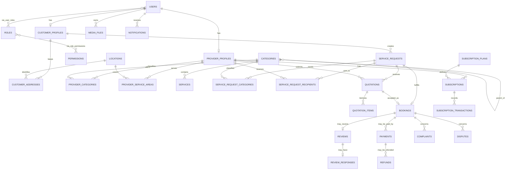

# SERV HUB Entity Relationship Diagram

The diagram shows the core marketplace flow and the most important supporting
relationships. Each join table and supporting domain is represented in the
Prisma schema even where it is omitted here for readability.

Locations use one adjacency-list table with a `LocationType` of `PROVINCE`,
`DISTRICT`, `CITY`, or `TOWN`; this keeps the hierarchy extensible without
duplicating geographic attributes. Media rows contain storage keys and
metadata only. File bytes and temporary signed URLs are not stored in Postgres.

